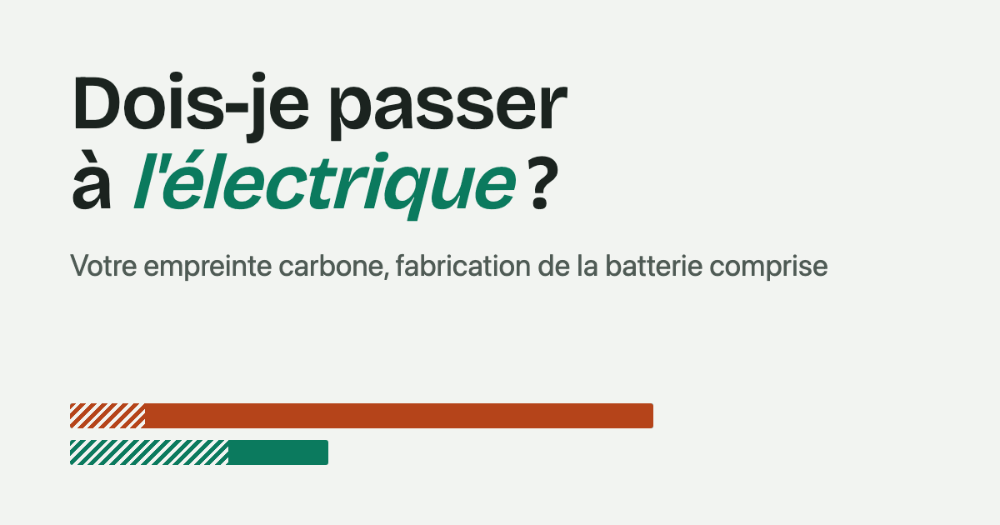
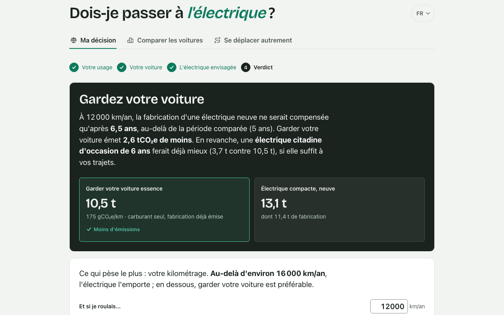
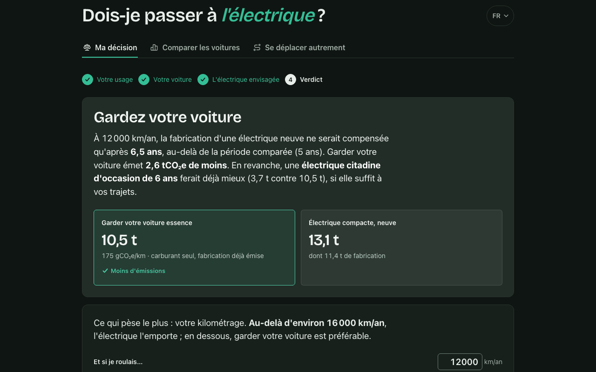
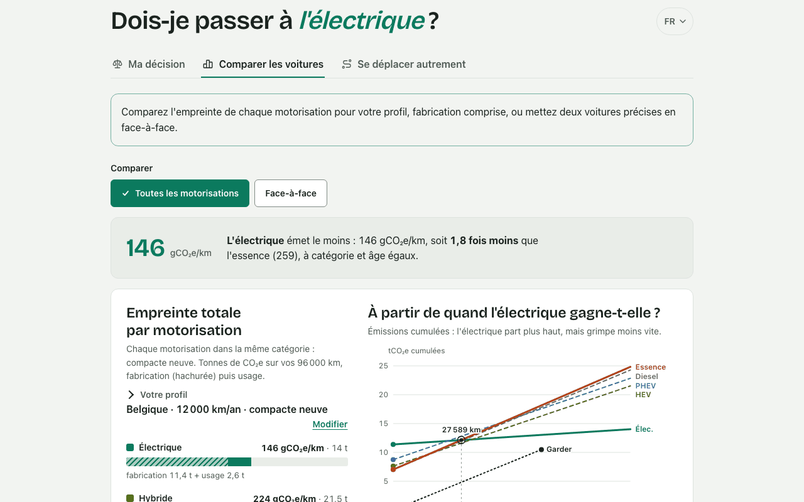
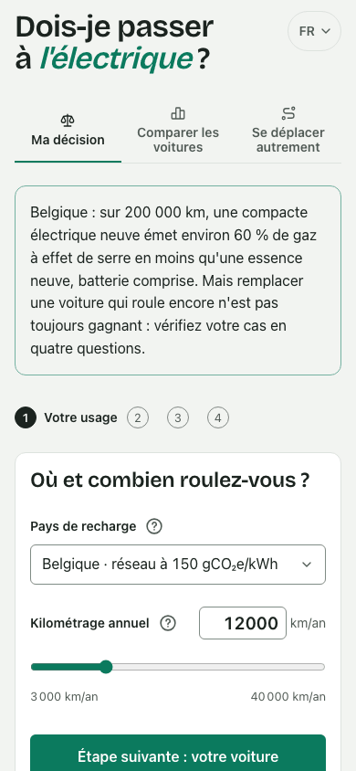

# Should I switch to electric? · Dois-je passer à l'électrique ?

[](LICENSE)
[](https://github.com/ggustin93/electric-switch/actions/workflows/deploy.yml)
[](#eco-design-and-performance)
[](#eco-design-and-performance)
[](https://electricornot.eu)

**A life-cycle CO₂e simulator that answers one personal question: should *you* keep your current car, or switch to an electric one, new or used?** Manufacturing and use are both counted, every assumption is numbered and sourced, and the whole site is eco-designed: one request per page, no third-party script, EcoIndex A.

**Live:** [electricornot.eu](https://electricornot.eu) — [français](https://electricornot.eu/fr/) · [English](https://electricornot.eu/en/) · [Nederlands](https://electricornot.eu/nl/) · [italiano](https://electricornot.eu/it/) · [español](https://electricornot.eu/es/)

[](https://electricornot.eu/fr/)

<details>
<summary><strong>🇫🇷 En bref</strong></summary>

Un simulateur pédagogique qui compare, sur tout le cycle de vie (fabrication + usage), garder sa voiture thermique ou passer à une électrique, neuve ou d'occasion. Le verdict est personnel : il dépend du pays de recharge, du kilométrage, de la voiture actuelle et de l'électrique envisagée. Chaque hypothèse est numérotée et sourcée dans la page [Méthode](https://electricornot.eu/fr/methode/) ; les écarts inférieurs à 10 % sont déclarés serrés. Le site est écoconçu (EcoIndex A, une requête par page, aucun script tiers) et disponible en cinq langues. Le code est publié sous licence MIT ; les signalements d'erreurs sont les bienvenus.

</details>

## What it answers

Most comparisons give an *average*: an electric car emits less than a petrol car over its life. That is true, but it is not the decision a driver faces. Their current car is already built; its manufacturing is sunk carbon. The real question is whether the fuel they would still burn outweighs the manufacturing of the electric car they would buy, over the years they would actually keep it.

The simulator asks four things (where you charge, how far you drive, which car you have, which electric car you consider) and returns a verdict in about a minute:

- **« Gardez votre voiture »** or **« Oui, passez à l'électrique »**, with the tonnes of CO₂e at stake and the break-even mileage;
- a **« serré »** (too close to call) verdict when the gap is under 10 %, the model's own uncertainty band;
- one concrete alternative when keeping wins, such as a lighter or used electric car that would already do better.

Two more tabs compare every powertrain (petrol, diesel, hybrid, plug-in hybrid, electric) for your profile, including a cumulative-emissions curve and a running-cost estimate, and put cars next to other ways of travelling (ADEME Impact CO₂ data).

## Screenshots

| Verdict | Dark theme |
|---|---|
|  |  |

| Compare powertrains | Mobile |
|---|---|
|  |  |

## How it works

- **Scope:** manufacturing (body plus battery, from vehicle mass and battery capacity) and use (fuel or grid electricity) in CO₂e, over the kilometres you will drive. Recycling credits are deliberately left out and the vehicle life is set below the ICCT's: both choices lean against the electric car, so its advantage is not overstated.
- **Your current car** carries no manufacturing: it already exists. A **new electric car** carries 100 % of its manufacturing (marginal convention, H3). A **used electric car** carries the share of its value you consume while you own it (economic allocation, H2, ADR 0012), with the remaining share shown as a high estimate.
- **Grid:** 14 national grids (Belgium, France, Germany, the Netherlands, Italy, Spain, Poland, Norway, Sweden, the UK, the EU average, the US, China, India), each decarbonising over the comparison period.
- **Vehicles:** 5 size categories, 5 powertrains, battery chemistry (NMC, LFP, EU sales mix), odometer and age for used cars.
- **Honesty rules:** results are orders of magnitude (about ±20 %); gaps under 10 % are reported as ties; the assumptions page lists 13 numbered hypotheses (H1–H13) and 27 sources (Carbone 4, ICCT, Ember, Electricity Maps, ADEME, IPCC AR5, ISO 14044, RTE, Eurostat…), each with its verification status in [`docs/research/`](docs/research/).
- **Decisions** that shaped the model and the site are recorded as ADRs in [`docs/adr/`](docs/adr/): allocation conventions, used-car estimates, early replacement, odometer and age, energy prices at build time, hosting, audience measurement.

The full method, in five languages: [electricornot.eu/fr/methode/](https://electricornot.eu/fr/methode/).

## Eco-design and performance

The site is built to have the lowest footprint we could reach for the service it renders, following the INR / RGESN eco-design rules.

- **One request per page.** Each language and page is a single self-contained HTML file (CSS, JavaScript, a 13.7 kB subset of the title font and the icons inlined), pre-rendered at build time. No external font, no image, no third-party script, no cookie.
- **About 62 kB compressed** for the simulator, with a strict Content-Security-Policy (`default-src 'none'`, scripts and styles allowed by hash).
- **Energy prices are fetched at build time**, never in the visitor's browser (ADR 0011); a weekly workflow refreshes them.
- **Audience measurement without cookies or identifiers** (Umami Cloud, EU region): one small request per page, events on actions, Do Not Track, GPC and an opt-out link respected (ADR 0015).
- **The build fails** if any of the 30 pages drops below EcoIndex A ([`src/ecoindex.js`](src/ecoindex.js), official CNUMR method).

### EcoIndex (computed on the built pages, 2026-10-16)

| Page (/fr/) | DOM nodes | Weight (gzip) | EcoIndex |
|---|---:|---:|---|
| simulator | 92 | 62.5 kB | 92 (A) |
| methode | 103 | 69.0 kB | 92 (A) |
| questions | 83 | 63.0 kB | 93 (A) |
| ecoconception | 84 | 62.8 kB | 93 (A) |
| apropos | 63 | 64.1 kB | 94 (A) |
| mentions | 61 | 62.5 kB | 94 (A) |

Reproduce with `npm run build && node scripts/scores.mjs [lang]`. The official tool, [ecoindex.fr](https://www.ecoindex.fr), measured 93 (Questions) and 92 (Méthode) on 2026-10-12.

### Lighthouse 13.5 (production, 2026-10-16)

| https://electricornot.eu/fr/ | Performance | Accessibility | Best practices | SEO |
|---|:---:|:---:|:---:|:---:|
| Mobile (simulated Moto G, slow 4G) | 100 | 100 | 100 | 100 |
| Desktop | 100 | 100 | 100 | 100 |

Mobile metrics: first contentful paint 1.2 s, largest contentful paint 2.2 s, total blocking time 0 ms, cumulative layout shift 0. Desktop: FCP 0.4 s, LCP 0.6 s.

Accessibility targets WCAG 2.2 AA: keyboard-operable tabs and steps, visible focus, landmarks, labels on every control, light and dark themes following the system preference.

## Tech

- **[Preact](https://preactjs.com) 10 + [Vite](https://vite.dev) 8**, no router, no state library, no UI kit (ADR 0003, 0004). The whole app is one component file plus a pure model.
- **Pure model** in [`src/model.js`](src/model.js): every figure the site shows comes from it, and [`src/reponses.test.js`](src/reponses.test.js) checks that the numbers published on the Questions page still match the model.
- **Pre-rendered static pages** (`preact-render-to-string`): 5 languages × 6 pages, canonical and hreflang links, JSON-LD, sitemap, `llms.txt`, a `.htaccess` with security headers (ADR 0006, 0008, 0009).
- **83 tests** with Node's built-in `node:test`, no test framework: model, scenarios, i18n keys, headers, SEO, prices, measurement.
- **Hosting:** Infomaniak (Switzerland) static hosting (ADR 0010). **CI:** GitHub Actions runs the tests, builds, mirrors `dist/` over FTP, then verifies the live site byte for byte and pings IndexNow.

## Run locally

```bash
npm install
npm run dev          # http://localhost:5173, French by default
LANGUE=nl npm run dev
npm test             # 83 tests, node:test
npm run build        # dist/: 5 languages × 6 pages; fails below EcoIndex A
node scripts/scores.mjs   # EcoIndex table of the built pages
```

Requires Node 22. The production URL is read from `SITE_URL` at build time (ADR 0008).

## Project layout

```
src/model.js          the model: emission factors, allocation, verdict, break-even
src/App.jsx           the whole UI (tabs, 4-step wizard, comparator, reading pages)
src/i18n/{fr,en,nl,it,es}.jsx   every UI string; French is the source, same keys everywhere
src/ecoindex.js       EcoIndex calculation used as a build gate
src/mesure.js         cookieless audience measurement
src/prix.json         energy prices, refreshed weekly by scripts/prix.mjs
build.mjs             builds the 30 pages, sitemap, robots, llms.txt, .htaccess
scripts/              prices, previews, scores, IndexNow, post-deploy check
docs/adr/             architecture and model decisions (ADR 0001–0015)
docs/research/        source verification of every hypothesis
PRODUCT.md · DESIGN.md · GLOSSARY.md · CHANGELOG.md
```

## Data sources and licences

The code is under the [MIT licence](LICENSE). Third-party work (Tabler Icons, Bricolage Grotesque, ADEME Impact CO₂ data, EU energy price data) and its licences are listed in [NOTICE.md](NOTICE.md). Emission factors taken from published studies are cited on the Method page and in `docs/research/`.

## Contributing

The most useful contribution is a correction. If a value, a source or an assumption looks wrong, [open an issue](https://github.com/ggustin93/electric-switch/issues) with the reference you have: each hypothesis has a verification status in [`docs/research/2026-10-verification-hypotheses.md`](docs/research/2026-10-verification-hypotheses.md), and the model is a single file with tests. Translations in Dutch, Italian and Spanish were produced with AI and reviewed, but not yet by a native speaker: a review is welcome.

Before a pull request: `npm test` and `npm run build` must pass (the build enforces EcoIndex A), and UI strings go in all five dictionaries.

## Author

Made by [Guillaume Gustin](https://pwablo.be) (Pwablo, Brussels), independent of any carmaker. Generative AI tools were used for part of the code, the texts and the literature search; the model's values were re-checked against the primary sources cited on the Method page. The simulator itself runs a deterministic model in your browser.

To cite: Gustin, G. (2026). *Dois-je passer à l'électrique ?*, version 7.9, [electricornot.eu](https://electricornot.eu).
